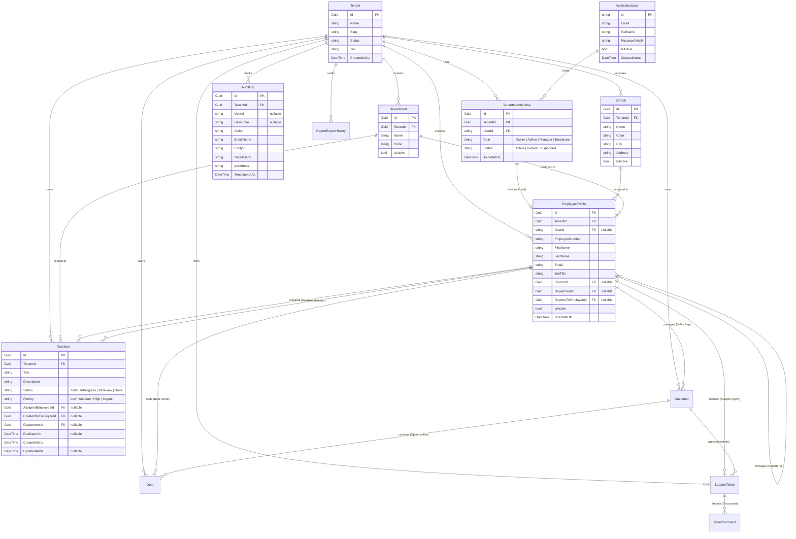

# Orbit Business Suite — Data Model & Tenancy Strategy

## 1. Tenancy Model Strategy

### Selected Architecture: Shared Database with Logical Tenant Isolation (Discriminator Column)
- **Rationale:** 
  1. High operational agility: Zero friction in tenant onboarding (no per-tenant database provisioning or connection-string management).
  2. Cost efficiency: Ideal for scalable SaaS on standard VPS or cloud SQL instances.
  3. Safe and Reversible: Can transition to hybrid or database-per-tenant for large enterprise tenants later if isolated compliance or customer-managed keys are requested.
- **Enforcement Mechanism:**
  - Every tenant-scoped entity implements `ITenantScopedEntity` containing `Guid TenantId { get; set; }`.
  - EF Core `OrbitDbContext` applies Global Query Filters automatically to all `ITenantScopedEntity` instances matching `_tenantContext.CurrentTenantId`.
  - Application services perform defensive checks on creation, ensuring `entity.TenantId == _tenantContext.CurrentTenantId`.
  - System-level queries (e.g. cross-tenant billing aggregations or superadmin audit) must explicitly call `.IgnoreQueryFilters()` with dedicated authorization policies.

---

## 2. Entity Relationship Diagram (Core Foundation & Tasks)

---

## 3. Entity Specification

### 3.1 Tenant (Company)
- `Id`: `Guid` Primary Key.
- `Name`: `string(150)`, required. The legal or display name of the customer company.
- `Slug`: `string(50)`, unique index. URL-friendly identifier for vanity URLs or tenant identification.
- `Status`: `TenantStatus` Enum (`Active`, `Suspended`, `PendingSetup`).
- `CreatedAtUtc`: `DateTime`.

### 3.2 TenantMembership
- Resolves the M:N relationship between an authentication `ApplicationUser` and a `Tenant`.
- `TenantId`: `Guid` Foreign Key to `Tenant`.
- `UserId`: `string` Foreign Key to `ApplicationUser`.
- `Role`: `TenantRole` Enum (`Owner`, `Admin`, `Manager`, `Employee`).
- `Status`: `MembershipStatus` Enum (`Active`, `Invited`, `Suspended`).

### 3.3 EmployeeProfile
- Domain entity for employment details. Decoupled from `ApplicationUser`.
- `UserId`: Optional link to `ApplicationUser` if the employee has been provisioned system login access.
- `ReportsToEmployeeId`: Self-referencing Foreign Key establishing manager-to-direct-report hierarchy for task visibility.

### 3.4 TaskItem
- Represents actionable business work items.
- Scope: Tenant-scoped, optionally scoped to a Department.
- Permissions:
  - An `Employee` can query tasks where `AssignedEmployeeId == CurrentUserEmployeeId`.
  - A `Manager` can query tasks where `AssignedEmployee.ReportsToEmployeeId == CurrentUserEmployeeId` OR tasks within their managed department.
  - An `Admin` or `Owner` can query all tasks within the tenant.

### 3.5 Customer (CRM & Sales)
- Represents client organizations, accounts, and prospective leads.
- Scope: Tenant-scoped (`ITenantScopedEntity`), auditable (`IAuditableEntity`).
- Fields:
  - `Id`: `Guid` Primary Key.
  - `TenantId`: `Guid` Foreign Key to `Tenant`.
  - `CompanyName`: `string(200)`, required.
  - `ContactPerson`: `string(150)`, primary business contact.
  - `Email`: `string(150)`, contact email address.
  - `Phone`: `string(50)`, telephone number.
  - `Website`: `string(200)`, corporate website.
  - `Industry`: `string(100)`, business vertical.
  - `Status`: `CustomerStatus` Enum (`Lead`, `Prospect`, `ActiveCustomer`, `Inactive`).
  - `AssignedEmployeeId`: Optional `Guid` Foreign Key to `EmployeeProfile` (assigned sales representative).
  - `Notes`: `string(2000)`, strategic relationship notes.
- Permissions:
  - `Employee`: Can view and edit accounts where `AssignedEmployeeId == CurrentUserEmployeeId`.
  - `Manager`: Can view and supervise accounts assigned to themselves and their direct reports.
  - `Owner` / `Admin`: Complete tenant-wide visibility across all accounts.
  - Deletion restricted to Manager, Admin, and Owner.

### 3.6 Deal (CRM Opportunity & Pipeline)
- Represents commercial deals, sales pipeline stages, and revenue forecasts.
- Scope: Tenant-scoped (`ITenantScopedEntity`), auditable (`IAuditableEntity`).
- Fields:
  - `Id`: `Guid` Primary Key.
  - `TenantId`: `Guid` Foreign Key to `Tenant`.
  - `Title`: `string(200)`, required.
  - `CustomerId`: `Guid` Foreign Key to `Customer` (restrict delete).
  - `AssignedEmployeeId`: Optional `Guid` Foreign Key to `EmployeeProfile` (deal owner/representative).
  - `Amount`: `decimal(18, 2)`, required commercial opportunity value.
  - `Currency`: `string(10)`, e.g. "USD".
  - `Stage`: `DealStage` Enum (`Lead`, `Qualified`, `Proposal`, `Negotiation`, `ClosedWon`, `ClosedLost`).
  - `Probability`: `int` (0 to 100).
  - `ExpectedCloseDateUtc`: Optional `DateTime`.
  - `ClosedAtUtc`: Optional `DateTime` (populated automatically upon Won/Lost).
  - `LostReason`: Optional `string(500)`.
  - `Notes`: Optional `string(2000)`.
- Permissions:
  - `Employee`: Can view, create, and modify deals assigned to them.
  - `Manager`: Can view and modify deals assigned to themselves and their direct reporting team.
  - `Owner` / `Admin`: Complete tenant-wide visibility across all opportunities and forecast metrics.
  - Deletion restricted to Manager, Admin, and Owner.

### 3.7 SupportTicket (Helpdesk & Case Governance)
- Represents client incidents, inquiries, and technical issues.
- Scope: Tenant-scoped (`ITenantScopedEntity`), auditable (`IAuditableEntity`).
- Fields:
  - `Id`: `Guid` Primary Key.
  - `TenantId`: `Guid` Foreign Key to `Tenant`.
  - `TicketNumber`: `string(50)`, unique per tenant (e.g. `TCK-1001`).
  - `Subject`: `string(200)`, required.
  - `Description`: `string(4000)`, required.
  - `CustomerId`: `Guid` Foreign Key to `Customer` (restrict delete).
  - `AssignedEmployeeId`: Optional `Guid` Foreign Key to `EmployeeProfile`.
  - `CreatedByEmployeeId`: Optional `Guid` Foreign Key to `EmployeeProfile`.
  - `Status`: `TicketStatus` Enum (`Open`, `Pending`, `Resolved`, `Closed`).
  - `Priority`: `TicketPriority` Enum (`Low`, `Medium`, `High`, `Urgent`).
  - `Category`: `TicketCategory` Enum (`Technical`, `Billing`, `Product`, `Account`, `General`).
  - `ResolvedAtUtc`: Optional `DateTime`.
  - `ClosedAtUtc`: Optional `DateTime`.
  - `ResolutionSummary`: Optional `string(2000)`.
- Permissions:
  - `Employee`: Can view and modify tickets assigned to them or created by them.
  - `Manager`: Can view and modify tickets within their reporting team.
  - `Owner` / `Admin`: Complete tenant-wide case visibility and SLA oversight.
  - Deletion restricted to Manager, Admin, and Owner.

### 3.8 TicketComment (Case Timeline)
- Threaded conversation entries attached to a support ticket.
- Fields:
  - `Id`: `Guid` Primary Key.
  - `TenantId`: `Guid` Foreign Key to `Tenant`.
  - `TicketId`: `Guid` Foreign Key to `SupportTicket` (cascade delete).
  - `AuthorEmployeeId`: Optional `Guid` Foreign Key to `EmployeeProfile`.
  - `AuthorName`: `string(100)`.
  - `CommentText`: `string(2000)`.
  - `IsInternal`: `bool` (flags internal engineering/support notes hidden from clients).
  - `CreatedAtUtc`: `DateTime`.

### 3.9 Product (Catalog & SKU Governance)
- Represents master items in the company's product and materials catalog.
- Scope: Tenant-scoped (`ITenantScopedEntity`), auditable (`IAuditableEntity`).
- Fields:
  - `Id`: `Guid` Primary Key.
  - `TenantId`: `Guid` Foreign Key to `Tenant`.
  - `Sku`: `string(100)`, unique per tenant (e.g. `GW-TITAN-X1`).
  - `Name`: `string(200)`, required.
  - `Description`: Optional `string(2000)`.
  - `Category`: `ProductCategory` Enum (`Hardware`, `Software`, `Electronics`, `RawMaterials`, `Components`, `FinishedGoods`, `Services`).
  - `UnitOfMeasure`: `string(50)` (e.g. "pcs", "units", "kg", "license").
  - `UnitPrice`: `decimal(18, 2)`, selling price to customers.
  - `UnitCost`: `decimal(18, 2)`, cost basis for inventory valuation.
  - `ReorderLevel`: `decimal(18, 2)`, minimum threshold triggering replenishment alerts.
  - `IsActive`: `bool`, default `true`.
- Permissions:
  - `Employee`: Read-only access to catalog items and stock levels.
  - `Manager`, `Admin`, `Owner`: Create, update, and manage catalog items and price book data.

### 3.10 ProductInventory (Multi-Location Warehouse Allocation)
- Represents physical stock quantities allocated to specific warehouse branches.
- Scope: Tenant-scoped (`ITenantScopedEntity`), auditable (`IAuditableEntity`).
- Fields:
  - `Id`: `Guid` Primary Key.
  - `TenantId`: `Guid` Foreign Key to `Tenant`.
  - `ProductId`: `Guid` Foreign Key to `Product` (cascade delete).
  - `BranchId`: `Guid` Foreign Key to `Branch` (restrict delete).
  - `QuantityOnHand`: `decimal(18, 2)`, physical units on hand.
  - `QuantityReserved`: `decimal(18, 2)`, committed units pending fulfillment.
  - `QuantityAvailable`: Computed property (`QuantityOnHand - QuantityReserved`).
  - `AisleBinLocation`: Optional `string(100)` (e.g. "Aisle 3, Shelf B, Bin 12").
- Indexes:
  - Unique composite index on `(TenantId, ProductId, BranchId)`.

### 3.11 StockMovement (Immutable Inventory Ledger)
- Append-only transactional ledger recording every stock adjustment, transfer, and consumption event.
- Scope: Tenant-scoped (`ITenantScopedEntity`), auditable (`IAuditableEntity`).
- Fields:
  - `Id`: `Guid` Primary Key.
  - `TenantId`: `Guid` Foreign Key to `Tenant`.
  - `ProductId`: `Guid` Foreign Key to `Product` (restrict delete).
  - `BranchId`: `Guid` Foreign Key to `Branch` (source location).
  - `DestinationBranchId`: Optional `Guid` Foreign Key to `Branch` (destination for transfers).
  - `Type`: `StockMovementType` Enum (`Receipt`, `AdjustmentIn`, `AdjustmentOut`, `Transfer`, `SaleShipment`, `Scrap`).
  - `Quantity`: `decimal(18, 2)`, units adjusted.
  - `UnitCost`: Optional `decimal(18, 2)`, valuation snapshot at transaction time.
  - `ReferenceNumber`: Optional `string(100)` (e.g. PO, SO, or Cycle Count ID).
  - `Reason`: Optional `string(500)`.
  - `PerformedByEmployeeId`: Optional `Guid` Foreign Key to `EmployeeProfile`.
  - `TimestampUtc`: `DateTime`, immutable transaction timestamp.

### 3.12 Invoice (Client Billing Statement)
- Represents commercial invoices issued to customers for products and services.
- Scope: Tenant-scoped (`ITenantScopedEntity`), auditable (`IAuditableEntity`).
- Fields:
  - `Id`: `Guid` Primary Key.
  - `TenantId`: `Guid` Foreign Key to `Tenant`.
  - `InvoiceNumber`: `string(50)`, unique sequential number per tenant (e.g. `INV-2026-0001`).
  - `CustomerId`: `Guid` Foreign Key to `Customer` (restrict delete).
  - `DealId`: Optional `Guid` Foreign Key to `Deal`.
  - `IssueDateUtc`: `DateTime`, billing statement date.
  - `DueDateUtc`: `DateTime`, payment deadline date.
  - `Currency`: `string(10)`, e.g. "USD".
  - `SubTotal`: `decimal(18, 2)`, sum of line items before tax and discount.
  - `TaxRate`: `decimal(5, 2)`, percentage tax rate (e.g. 10.00).
  - `TaxAmount`: `decimal(18, 2)`, calculated tax sum.
  - `DiscountAmount`: `decimal(18, 2)`, aggregate invoice discount.
  - `TotalAmount`: `decimal(18, 2)`, final payable total (`SubTotal - Discount + Tax`).
  - `AmountPaid`: `decimal(18, 2)`, total payments collected to date.
  - `BalanceDue`: `decimal(18, 2)`, remaining accounts receivable (`TotalAmount - AmountPaid`).
  - `Status`: `InvoiceStatus` Enum (`Draft`, `Issued`, `PartiallyPaid`, `Paid`, `Overdue`, `Void`).
  - `Notes`: Optional `string(2000)`.
  - `TermsAndConditions`: Optional `string(2000)`.
- Indexes:
  - Composite unique index on `(TenantId, InvoiceNumber)`.
- Permissions:
  - `Employee`: Read-only visibility for invoices of customers they manage.
  - `Manager`, `Admin`, `Owner`: Create, issue, void, and record payments for invoices.
  - Hard deletion is prohibited for non-draft invoices (must use `VoidInvoice`).

### 3.13 InvoiceItem (Billing Line Item)
- Individual product or service items billed on an invoice.
- Fields:
  - `Id`: `Guid` Primary Key.
  - `TenantId`: `Guid` Foreign Key to `Tenant`.
  - `InvoiceId`: `Guid` Foreign Key to `Invoice` (cascade delete).
  - `ProductId`: Optional `Guid` Foreign Key to `Product`.
  - `Description`: `string(500)`, required item line description.
  - `Quantity`: `decimal(18, 2)`, quantity billed.
  - `UnitPrice`: `decimal(18, 2)`, unit selling price.
  - `TaxAmount`: `decimal(18, 2)`, prorated tax amount.
  - `TotalAmount`: `decimal(18, 2)`, computed line total (`Quantity * UnitPrice + TaxAmount`).

### 3.14 PaymentRecord (Cash Receipts Ledger)
- Append-only financial ledger of client payments credited against issued invoices.
- Scope: Tenant-scoped (`ITenantScopedEntity`), auditable (`IAuditableEntity`).
- Fields:
  - `Id`: `Guid` Primary Key.
  - `TenantId`: `Guid` Foreign Key to `Tenant`.
  - `PaymentNumber`: `string(50)`, unique sequential number per tenant (e.g. `PAY-2026-0001`).
  - `InvoiceId`: `Guid` Foreign Key to `Invoice` (restrict delete).
  - `Amount`: `decimal(18, 2)`, payment amount received.
  - `PaymentDateUtc`: `DateTime`, payment transaction timestamp.
  - `Method`: `PaymentMethod` Enum (`BankTransfer`, `CreditCard`, `Check`, `Cash`, `Electronic`).
  - `ReferenceNumber`: Optional `string(100)` (e.g. bank wire reference or card auth code).
  - `Notes`: Optional `string(1000)`.
  - `RecordedByEmployeeId`: Optional `Guid` Foreign Key to `EmployeeProfile`.
- Indexes:
  - Composite unique index on `(TenantId, PaymentNumber)`.
- Invariants:
  - Overpayments exceeding invoice `BalanceDue` are rejected with domain exceptions.
  - Decrements `BalanceDue` and increments `AmountPaid` atomically.

### 3.15 WorkOrder (Manufacturing Production Order)
- Represents commercial and physical production runs scheduled at plant facilities.
- Scope: Tenant-scoped (`ITenantScopedEntity`), auditable (`IAuditableEntity`).
- Fields:
  - `Id`: `Guid` Primary Key.
  - `TenantId`: `Guid` Foreign Key to `Tenant`.
  - `OrderNumber`: `string(50)`, unique sequential number per tenant (e.g. `WO-2026-0001`).
  - `ProductId`: `Guid` Foreign Key to `Product` (finished good to manufacture, restrict delete).
  - `BillOfMaterialsId`: Optional `Guid` Foreign Key to `BillOfMaterials` (set null on delete).
  - `BranchId`: `Guid` Foreign Key to `Branch` (manufacturing plant facility, restrict delete).
  - `AssignedEmployeeId`: Optional `Guid` Foreign Key to `EmployeeProfile` (lead production engineer/operator).
  - `QuantityTarget`: `decimal(18, 2)`, planned production quota.
  - `QuantityProduced`: `decimal(18, 2)`, actual yield delivered to stock.
  - `Status`: `WorkOrderStatus` Enum (`Draft`, `Planned`, `InProgress`, `Completed`, `Cancelled`).
  - `Priority`: `WorkOrderPriority` Enum (`Low`, `Medium`, `High`, `Urgent`).
  - `StartDateUtc`: Optional `DateTime`, set automatically upon entering `InProgress`.
  - `DueDateUtc`: Optional `DateTime`, targeted completion deadline.
  - `CompletedDateUtc`: Optional `DateTime`, recorded upon status `Completed`.
  - `Notes`: Optional `string(2000)`.
- Indexes:
  - Composite unique index on `(TenantId, OrderNumber)`.
  - Composite index on `(TenantId, Status)`.
  - Composite index on `(TenantId, BranchId)`.
- Invariants:
  - Only `Draft` orders can be deleted; non-draft orders must be formally cancelled.
  - Transitioning to `Completed` atomically increments branch `ProductInventory.QuantityOnHand` and logs a `StockMovement` receipt.
  - Completed orders cannot be cancelled or reverted.

### 3.16 BillOfMaterials (Formulation Recipe)
- Master formulation recipe defining the component requirements to assemble a finished product.
- Scope: Tenant-scoped (`ITenantScopedEntity`), auditable (`IAuditableEntity`).
- Fields:
  - `Id`: `Guid` Primary Key.
  - `TenantId`: `Guid` Foreign Key to `Tenant`.
  - `BomNumber`: `string(50)`, unique sequential number per tenant (e.g. `BOM-0001`).
  - `Name`: `string(150)`, recipe name.
  - `Description`: Optional `string(1000)`.
  - `ProductId`: `Guid` Foreign Key to `Product` (finished good, restrict delete).
  - `Version`: `string(20)`, default "v1.0".
  - `IsActive`: `bool`, default `true`.
- Indexes:
  - Composite unique index on `(TenantId, BomNumber)`.
  - Composite index on `(TenantId, ProductId)`.

### 3.17 BomItem (Recipe Component Part)
- Individual component SKU requirement within a Bill of Materials.
- Scope: Tenant-scoped (`ITenantScopedEntity`).
- Fields:
  - `Id`: `Guid` Primary Key.
  - `TenantId`: `Guid` Foreign Key to `Tenant`.
  - `BillOfMaterialsId`: `Guid` Foreign Key to `BillOfMaterials` (cascade delete).
  - `ComponentProductId`: `Guid` Foreign Key to `Product` (sub-part or raw material, restrict delete).
  - `QuantityRequired`: `decimal(18, 2)`, quantity consumed per finished unit.
  - `UnitOfMeasure`: `string(50)` (e.g. "pcs", "kg", "meters").
  - `Notes`: Optional `string(500)`.
- Indexes:
  - Composite index on `(TenantId, BillOfMaterialsId)`.

### 3.18 LeaveRequest (Time-Off & Leave Governance)
- Represents employee time-off, sick leave, or holiday requests.
- Scope: Tenant-scoped (`ITenantScopedEntity`), auditable (`IAuditableEntity`).
- Fields:
  - `Id`: `Guid` Primary Key.
  - `TenantId`: `Guid` Foreign Key to `Tenant`.
  - `RequestNumber`: `string(50)`, unique sequential number per tenant (e.g. `LR-2026-0001`).
  - `EmployeeId`: `Guid` Foreign Key to `EmployeeProfile` (applicant).
  - `LeaveType`: `LeaveType` Enum (`Annual`, `Sick`, `Unpaid`, `MaternityPaternity`, `Bereavement`, `Compensatory`).
  - `StartDateUtc`: `DateTime`, leave start date.
  - `EndDateUtc`: `DateTime`, leave end date.
  - `DaysCount`: `decimal(5, 2)`, requested duration in business days.
  - `Reason`: `string(1000)`, applicant explanation.
  - `Status`: `LeaveStatus` Enum (`Pending`, `Approved`, `Rejected`, `Cancelled`).
  - `ApproverEmployeeId`: Optional `Guid` Foreign Key to `EmployeeProfile`.
  - `ActionedAtUtc`: Optional `DateTime`, approval or rejection timestamp.
  - `RejectionReason`: Optional `string(1000)`.
- Indexes:
  - Composite unique index on `(TenantId, RequestNumber)`.
  - Composite index on `(TenantId, EmployeeId)`.
  - Composite index on `(TenantId, Status)`.

### 3.19 AttendanceLog (Daily Work Time Record)
- Represents daily check-in, check-out, and active shift duration for an employee.
- Scope: Tenant-scoped (`ITenantScopedEntity`), auditable (`IAuditableEntity`).
- Fields:
  - `Id`: `Guid` Primary Key.
  - `TenantId`: `Guid` Foreign Key to `Tenant`.
  - `EmployeeId`: `Guid` Foreign Key to `EmployeeProfile`.
  - `Date`: `DateTime`, date of work shift (midnight UTC).
  - `CheckInTimeUtc`: Optional `DateTime`, punch-in timestamp.
  - `CheckOutTimeUtc`: Optional `DateTime`, punch-out timestamp.
  - `TotalHours`: Optional `decimal(5, 2)`, total working hours rounded to two decimals.
  - `Status`: `AttendanceStatus` Enum (`Present`, `Late`, `HalfDay`, `Absent`, `OnLeave`).
  - `WorkLocation`: `string(100)` (e.g. "HQ - Main Campus", "Remote / Home Office").
  - `Notes`: Optional `string(500)`.
- Indexes:
  - Composite unique index on `(TenantId, EmployeeId, Date)`.
  - Composite index on `(TenantId, Date)`.

### 3.20 ShiftSchedule (Work Rota Configuration)
- Represents recurring shift assignments and operating hours for personnel.
- Scope: Tenant-scoped (`ITenantScopedEntity`), auditable (`IAuditableEntity`).
- Fields:
  - `Id`: `Guid` Primary Key.
  - `TenantId`: `Guid` Foreign Key to `Tenant`.
  - `EmployeeId`: `Guid` Foreign Key to `EmployeeProfile`.
  - `ShiftName`: `string(100)`, e.g. "Core Business Hours".
  - `ShiftType`: `ShiftType` Enum (`StandardDay`, `MorningShift`, `EveningShift`, `NightShift`, `Flexible`).
  - `StartTime`: `TimeSpan`, shift start time (e.g. 09:00:00).
  - `EndTime`: `TimeSpan`, shift end time (e.g. 17:30:00).
  - `EffectiveFromUtc`: `DateTime`, activation date.
  - `EffectiveToUtc`: Optional `DateTime`, expiration date.
  - `IsActive`: `bool`, default `true`.
  - `Notes`: Optional `string(500)`.
- Indexes:
  - Composite index on `(TenantId, EmployeeId)`.

### 3.21 ReportExportHistory (Executive Data Extraction & Audit Ledger)
- Represents an immutable forensic audit record for any operational or executive report exported from the system.
- Scope: Tenant-scoped (`ITenantScopedEntity`), auditable (`IAuditableEntity`).
- Fields:
  - `Id`: `Guid` Primary Key.
  - `TenantId`: `Guid` Foreign Key to `Tenant`.
  - `ReportType`: `ReportType` Enum (`FinancialSummary`, `SalesPipeline`, `InventoryValuation`, `SupportSla`, `WorkforceAttendance`).
  - `Format`: `ExportFormat` Enum (`Csv`, `Json`).
  - `FileName`: `string(255)`, generated download artifact file name.
  - `RecordCount`: `int`, total rows or entities included in the dataset.
  - `FileSizeKb`: `decimal(10, 2)`, exported byte payload size in kilobytes.
  - `ParametersJson`: Optional `string(2000)`, JSON-serialized filter parameters applied to the query.
  - `GeneratedByUserId`: `string(100)`, foreign identifier of the requesting user.
  - `CreatedAtUtc`: `DateTime`, timestamp of export generation.
- Indexes:
  - Composite index on `(TenantId, CreatedAtUtc)`.
  - Composite index on `(TenantId, ReportType)`.
- Invariants:
  - Records in `ReportExportHistory` are append-only and strictly immutable; exports cannot be modified or purged by tenants.
  - Tenant scoping ensures zero cross-tenant leakage of export audit trails.

